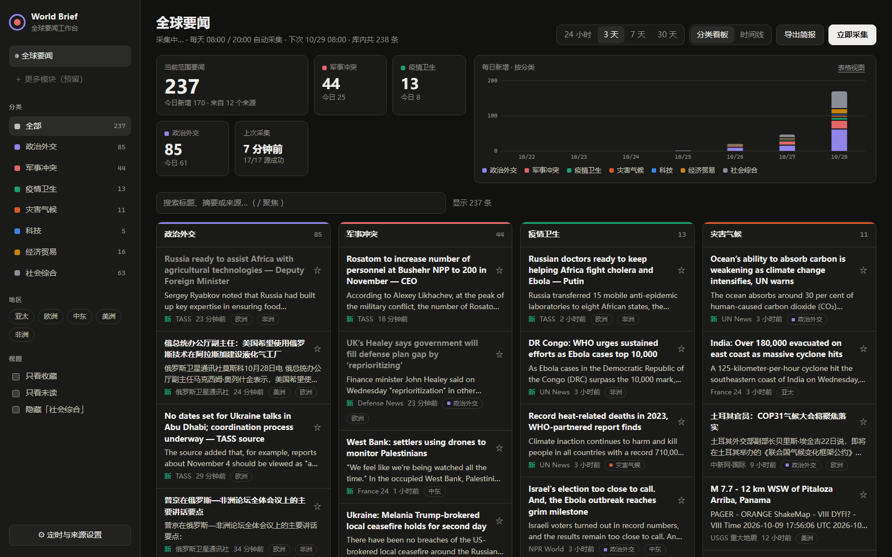

# 全球要闻 · World Brief

本地运行的全球大事工作台：每天定时从多家新闻源搜集最近的国际新闻，自动按 **政治外交 / 军事冲突 / 疫情卫生 / 灾害气候 / 科技 / 经济贸易 / 社会综合** 分类并标注地区，在网页看板里浏览、筛选、收藏、导出简报。

同时它也是一个 [Claude Code](https://claude.com/claude-code) skill：装好之后，可以直接让 Claude「给我今天的全球要闻简报」。



## 特性

- 零依赖：只需 Node.js 18+，不用 `npm install`
- 定时采集（默认每天 08:00、20:00），可在页面里修改时间和来源
- 中英文关键词分类 + 地区识别，每个来源单次有数量上限，避免刷屏
- 分类看板 / 时间线两种视图，每日趋势图，搜索、收藏、已读
- 一键导出 Markdown 简报
- Windows 托盘启动器 + 桌面快捷方式

## 安装为 Claude Code skill

```bash
git clone https://github.com/Darienwa/world-brief ~/.claude/skills/world-brief
```

## 直接运行

```bash
cd world-brief
node server.mjs        # 打开 http://localhost:4318
```

Windows 用户可以生成 exe 和桌面快捷方式「全球要闻」：

```powershell
powershell -ExecutionPolicy Bypass -File launcher\build.ps1
```

双击图标即可启动，服务在后台运行，托盘图标右键可「立即采集」或「退出」。

## 配置

`config.json`：`schedule` 采集时间、`lookbackHours` 抓取时间窗、`maxPerFeed` 单源上限、`feeds` 来源列表。

部分境外源（BBC、Al Jazeera 等）在某些网络下无法直连，默认关闭。使用代理时：命令行设置 `HTTPS_PROXY` 和 `NODE_USE_ENV_PROXY=1`；或用 exe 启动时在同目录放一个 `proxy.txt`，写入代理地址如 `http://127.0.0.1:7890`。

## 说明

- 服务只监听 `127.0.0.1`，没有登录验证，请勿直接暴露到公网。
- 分类基于关键词规则，难免误判，可在 `lib/classify.mjs` 中调整。
- 新闻内容版权归各来源所有，本工具只保存标题、摘要和原文链接。

## License

MIT
